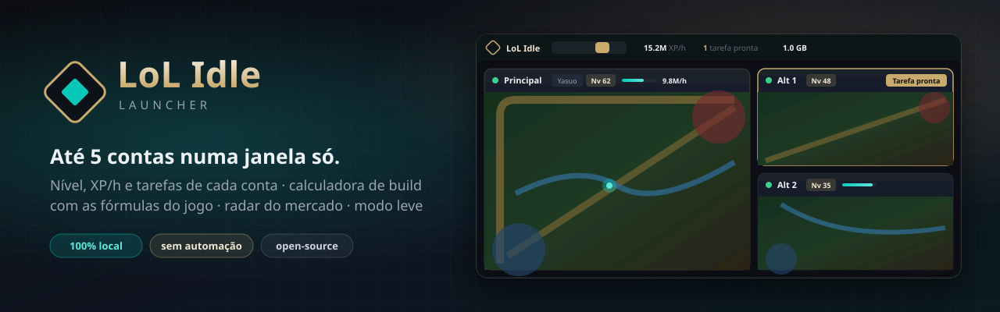
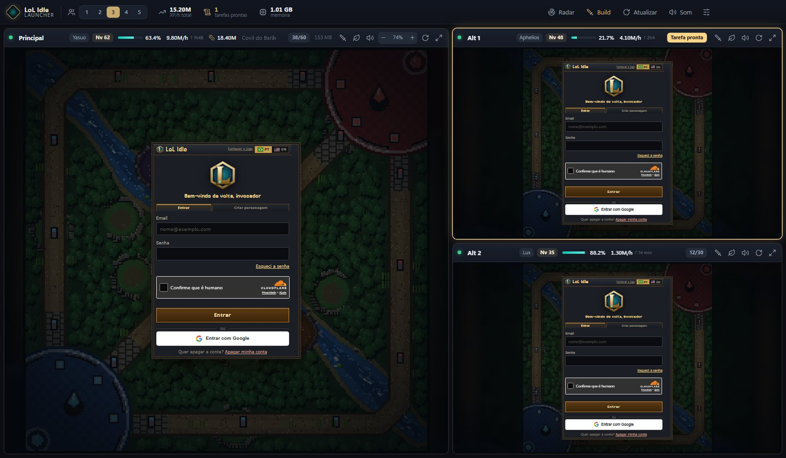
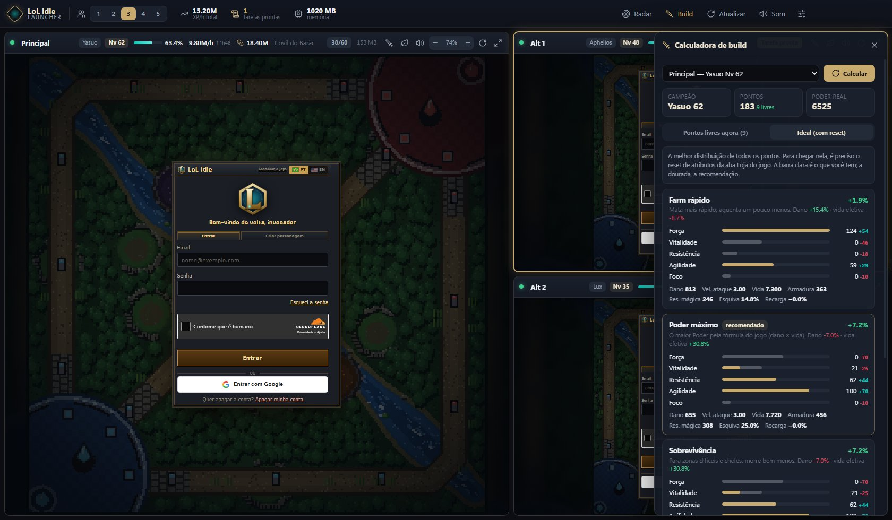
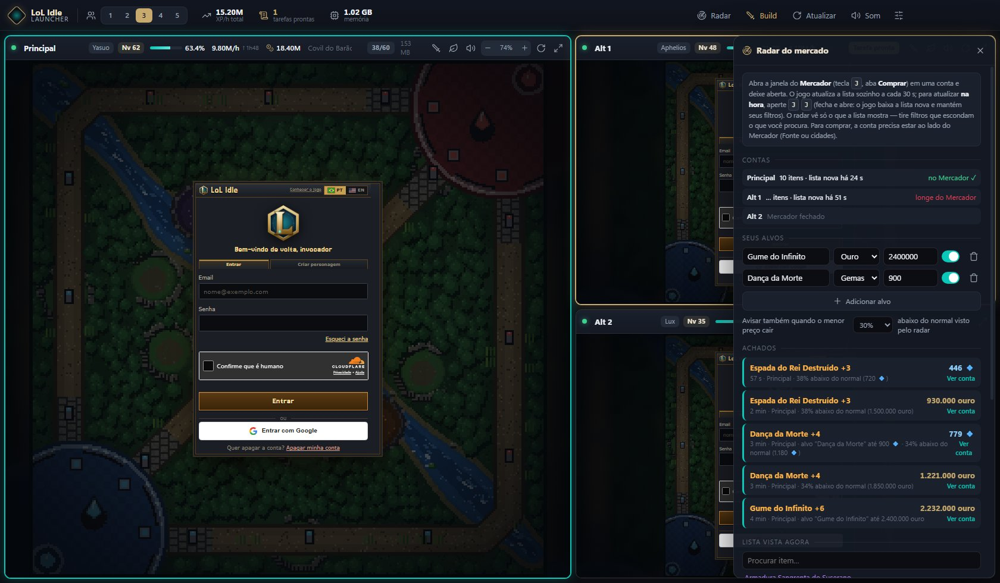

<p align="center">
  
</p>

<p align="center">
  
  
  
  
  
</p>

<p align="center">
  <a href="#-download">Download</a> ·
  <a href="#-funcionalidades">Funcionalidades</a> ·
  <a href="#-calculadora-de-build">Build</a> ·
  <a href="#-radar-do-mercado">Radar</a> ·
  <a href="#-memória">Memória</a> ·
  <a href="#-segurança-e-privacidade">Segurança</a> ·
  <a href="#-compilar-a-partir-do-código">Compilar</a> ·
  <a href="#-perguntas-frequentes">FAQ</a>
</p>

---

O **[LoL Idle](https://lolidle.com)** permite até **5 contas jogando ao mesmo tempo na mesma rede** (Termos de Uso, item 4.4). Fazer isso no navegador significa perfis separados, várias janelas e nenhuma visão geral.

O **Launcher LoL Idle** junta tudo em **uma janela**: cada conta roda isolada no seu próprio card, com nível, XP/h, ouro, zona e tarefa sempre à vista. Ele avisa quando a tarefa do Capitão da Legião fica pronta, calcula a melhor distribuição de atributos com as fórmulas do próprio jogo e vigia o mercado atrás dos itens que você quer.

> **Tudo roda no seu computador.** O launcher não tem servidor, não coleta dados, não envia nada para lugar nenhum e nunca vê a sua senha. **E não joga por você:** não clica, não digita, não compra — só mostra e avisa. O código está todo aqui para conferir.

<p align="center">
  
  <br>
  <sub>Modo leve com 3 contas: a principal em destaque e as alts empilhadas. XP/h total, tarefas prontas e memória no topo. <i>(Prints com contas e números de demonstração.)</i></sub>
</p>

## ⬇ Download

1. Baixe **`Launcher LoL Idle.exe`** na página de [**Releases**](../../releases/latest).
2. Dê dois cliques. É portátil: não instala nada.
3. Entre em cada conta no seu card (e-mail e senha, ou Google). O login fica guardado.

> O Windows pode mostrar *"O Windows protegeu o computador"* porque o executável não tem assinatura paga. Clique em **Mais informações → Executar assim mesmo**. O `.exe` de cada release é compilado pelo GitHub Actions a partir deste código, e o `SHA256.txt` ao lado permite conferir o arquivo.

> ⚠️ Não abra no navegador o mesmo personagem que está no launcher: o jogo aceita **uma página por personagem** e a outra para de salvar.

## ✨ Funcionalidades

| | |
|---|---|
| **1 a 5 contas** | Escolha quantas rodar no seletor do topo (o jogo permite até 5 na mesma rede). Conta desligada não abre e não usa memória. |
| **Contas isoladas** | Cada conta tem sua própria sessão, como um perfil de navegador separado. |
| **Painel por conta** | Campeão, nível, % de XP com barra, **XP/h** (últimos 10 min), tempo até o próximo nível, ouro e zona — lidos da tela do jogo. |
| **Tarefa pronta** 📜 | Quando a tarefa do **Capitão da Legião** termina, o card brilha, toca um alerta e sai uma notificação do Windows. O topo mostra quantas contas têm tarefa pronta — um clique leva à primeira. Aí é com você: `B` e fala com o Capitão. |
| **Calculadora de build** ⚔️ | Onde pôr os pontos de atributo — os livres agora e a distribuição ideal com reset — em três estilos, com as fórmulas do jogo. [Veja abaixo](#-calculadora-de-build). |
| **Radar do mercado** 📡 | Avisa quando um item da sua lista aparece abaixo do preço-alvo, ou bem abaixo do normal. [Veja abaixo](#-radar-do-mercado). |
| **Avisos que importam** | Captcha pedido pelo jogo, conta que parou de salvar, sem conexão: o card fica vermelho e você é avisado. |
| **Layout e zoom automáticos** | 3 contas: principal grande + duas empilhadas. 5 contas: 3 + 2. Também "lado a lado" e "empilhado". O jogo se ajusta ao tamanho do card; dá para ajustar o zoom à mão. |
| **Farm que não para** | Timers a 100% com o launcher minimizado, abertura escalonada, recarga automática se a conta travar, se o XP parar por 15 min ou se passar do limite de RAM (só com você longe da conta). Opções para o PC não dormir e para farmar com o Windows bloqueado. |
| **Modo leve** 🍃 | Um botão: 3 contas, o **Modo economia** do próprio jogo nelas (o mapa não é desenhado; a caça continua) e sem aceleração de vídeo. |

## ⚔️ Calculadora de build

<p align="center">
  
</p>

- Usa as **regras do próprio jogo**: importa o módulo de regras do LoL Idle dentro da conta e calcula com a mesma função que o jogo usa para mostrar seus atributos, mais a fórmula do **Poder real** (dano × vida).
- Lê da tela: campeão, nível, pontos em cada atributo, pontos livres e itens equipados. Bônus que não aparecem (conquistas, mascote, Codex, cartas) entram por calibração com os números que o jogo mostra.
- Três estilos: **Farm rápido**, **Poder máximo** (recomendado) e **Sobrevivência** — para os **pontos livres agora** (sem tirar nada do lugar) e para o **ideal com reset**.
- Cada ponto, pelas regras do jogo:

| Atributo | Cada ponto dá |
|---|---|
| Força | +1,2 de dano de ataque (campeões de magia: +2 de Poder de Habilidade) |
| Vitalidade | +20 de vida e +0,1 de regeneração por segundo |
| Resistência | +1,5 de armadura e +1 de resistência mágica |
| Agilidade | +0,8% de velocidade de ataque e +0,25% de esquiva (máx. 25%) |
| Foco | +8 de mana, +0,06 de regeneração de mana e −0,4% de recarga (máx. 30%) |

Yasuo, Katarina, Zac e Rengar não usam mana (o Foco muda neles) e o Ryze tem a Maestria Arcana — a calculadora trata cada caso. Ela **não coloca pontos**: você aplica na aba Atributos do jogo.

## 📡 Radar do mercado

<p align="center">
  
</p>

1. Abra a janela do **Mercador** (`J`, aba **Comprar**) em uma conta e deixe aberta.
2. O jogo atualiza a lista sozinho a cada 30 s. Para atualizar **na hora**, aperte **`J` `J`** (fecha e abre: o jogo baixa a lista nova e mantém seus filtros).
3. Cadastre seus alvos (nome, ouro ou Gemas, preço máximo) e/ou peça aviso quando o menor preço cair 20–50% abaixo do normal visto pelo radar.
4. Achou? O card pisca, toca o alerta e sai a notificação — com a indicação se a conta está **ao lado do Mercador** (só lá dá para comprar). **A compra é sua.**

O radar lê só o que a janela do jogo mostra — tire filtros que escondam o que você procura.

## 🚫 O que o launcher não faz — de propósito

Os [Termos de Uso do LoL Idle](https://lolidle.com/termos) proíbem *"programas, extensões, scripts, robôs, macros, emuladores de entrada ou qualquer automação externa"* (item 10.1), com suspensão ou banimento de todas as contas ligadas. O jogo também ignora e denuncia cliques que não vieram de uma pessoa. Por isso o launcher:

- **não compra sozinho** no mercado (ele avisa; você compra);
- **não entrega nem pega tarefas** (ele avisa; você aperta `B`);
- **não resolve captcha** (quando o jogo pede, você resolve);
- **não mexe na conexão nem no código do jogo** — só lê o que já está na tela.

Rodar até 5 contas na mesma rede é permitido pelos Termos (item 4.4); usar contas extras para juntar recursos, manipular o mercado ou o ranking não é (item 4.4-A).

## 🧠 Memória

Medido no Windows 11, telas de login (sem conta logada), versão 1.1:

| Configuração | RAM total |
|---|---|
| 3 contas, sem GPU (**padrão**) | **~1,5–1,6 GB** |
| 5 contas, com GPU | ~2,3 GB |

Depois do login o captcha some (~85 MB a menos por conta). O que mais pesa é o próprio jogo (o mapa); o **Modo economia** do jogo é o que mais economiza.

O que o launcher faz para gastar menos: modo "low-end" do Chromium, teto de memória por conta, rastreadores bloqueados (Cloudflare Insights e afins), "Desempenho leve" do jogo, aceleração de vídeo desligada por padrão, limpeza periódica de cache e reinício da conta que passar de 1,2 GB.

> O **isolamento de sites** do Chromium fica **ligado** de propósito. Desligar economizaria ~100 MB por conta, mas o captcha da Cloudflare passa a falhar e ninguém consegue logar.

## 🔒 Segurança e privacidade

- **Nada sai da sua máquina.** Sem servidor, sem telemetria, sem contas. A única coisa que o launcher abre é `https://lolidle.com`.
- **A senha é só do jogo.** Você digita dentro da página do jogo; o launcher não lê esses campos.
- **Contas isoladas** em sessões separadas (`%APPDATA%\launcher-lolidle\Partitions`).
- **Só leitura.** O script que roda em cada conta fica num mundo isolado: o jogo não o enxerga e ele não age no jogo — só lê textos e números da tela a cada 3 s.
- **Travas do Electron:** `sandbox`, `contextIsolation`, sem `nodeIntegration`; cada `<webview>` é validado antes de abrir e não navega para fora do lolidle.com (exceto o login do Google).

Detalhes em [SECURITY.md](SECURITY.md).

## 🛠 Como funciona por dentro

```
src/
├─ main.js                 janela, sessões isoladas, travas, RAM, energia
├─ preload/
│  ├─ game-preload.js      em cada conta: lê a tela (nível, XP, ouro, tarefa, mercado)
│  └─ ui-preload.js        ponte mínima interface ↔ processo principal
├─ game/
│  └─ build-engine.js      calculadora de build (injetada só quando você pede)
├─ renderer/               interface: renderer.js, radar.js, build.js, style.css
└─ demo/                   modo demonstração dos prints (fora do .exe)
```

Configuração: `%APPDATA%\launcher-lolidle\launcher-config.json`.

## 🧩 Compilar a partir do código

Precisa do [Node.js](https://nodejs.org) 22+.

```bash
git clone https://github.com/henriquecodo/launcher-lolidle.git
cd launcher-lolidle
npm ci
npm start          # roda em modo desenvolvimento
npm run dist       # gera dist\Launcher LoL Idle.exe
```

Prints do README sem conta real: `LAUNCHER_DEMO=contas` (ou `build`, `radar`) com `npm start` liga o modo demonstração.

## ❓ Perguntas frequentes

**O captcha fica em "Verificando…" ou dá "Falha na verificação".**
Recarregue a conta (↻ no card) e tente de novo, sem pressa: abrir várias contas ao mesmo tempo faz a Cloudflare desconfiar. Se você compilou mexendo no código, confira se não desligou o isolamento de sites.

**"Este personagem foi aberto em outra aba."**
O mesmo personagem está aberto em outro lugar (navegador, celular ou outro card). Feche lá e clique em "Jogar aqui" no jogo.

**Posso usar mais de 5 contas?**
Não. O jogo permite 5 jogando ao mesmo tempo na mesma rede; a sexta não salva.

**Por que o launcher não liga as automações do jogo, como o do PokeIdle?**
Porque o LoL Idle ignora cliques que não vieram de uma pessoa e os reporta ao servidor. Qualquer "clique por você" seria inútil e arriscado para as suas contas.

**O mapa ficou lento.**
Ligue a **Aceleração de vídeo (GPU)** nos Ajustes (vale ao reabrir), ou use o Modo economia do jogo.

## ⚖️ Aviso

Projeto independente, sem vínculo com o LoL Idle ou com a Riot Games. League of Legends é marca da Riot Games, Inc. Nenhum recurso do jogo é distribuído aqui — o jogo é carregado do site oficial. Veja [THIRD_PARTY_NOTICES.md](THIRD_PARTY_NOTICES.md).

Licença [MIT](LICENSE).
